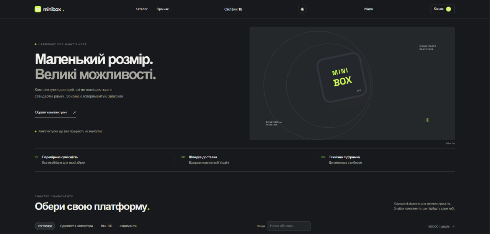

# MiniBox

<p align="center">
  
</p>

Демонстраційний full stack інтернет-магазин міні-ПК та комплектуючих. Проєкт показує роботу з каталогом, обліковими записами, замовленнями, залишками товару та realtime-подіями.

**Рівень проєкту:** junior+ навчальний проєкт. Він демонструє базову багатошарову архітектуру та окремі практики надійності, але не є готовою production e-commerce системою.

<p>
  
  
  
  
  
  
  
  
</p>

## Можливості

- Каталог із пошуком, категоріями, діапазоном цін, сортуванням і пагінацією.
- Реєстрація та вхід із JWT access token і ротацією refresh token.
- Кошик у браузері, оформлення замовлення з адресою доставки та історія замовлень користувача.
- Серверний розрахунок ціни зі знижкою та збереження назви/ціни товару на момент замовлення.
- Атомарне списання залишків із захистом від одночасної покупки останньої одиниці.
- SignalR-події замовлення й оновлення залишків; Redis-лічильник активних підключень.
- Фоновий симулятор каталогу, HTTP-запитів, checkout та SignalR-підключень.
- Docker Compose середовище з PostgreSQL, Redis, Prometheus і Grafana.

## Технічний огляд

### Архітектура

Рішення поділене на шари `Domain`, `Application`, `Infrastructure` і `Presentation`.

- **Domain** — сутності товару, залишків, користувачів і замовлень, value objects та доменні події.
- **Application** — MediatR handlers, FluentValidation validators та інтерфейси сервісів.
- **Infrastructure** — EF Core, PostgreSQL, Dapper, Redis, хешування паролів і генерація токенів.
- **Presentation** — ASP.NET Core REST API, SignalR hubs і окремий simulation engine.
- **Frontend** — TypeScript, Vite і CSS без UI-фреймворку. Сесія й кошик зберігаються в `localStorage`.

### Дані

- Каталог: `Categories`, `Products`, `ProductAttributes`, `ProductStocks`.
- Ідентифікація: `Users`, `RefreshTokens`. Email нормалізується; паролі хешуються PBKDF2-SHA256 із випадковою сіллю, refresh tokens зберігаються у вигляді SHA-256 хешу.
- Покупки: `Orders`, `OrderItems`. Позиція замовлення зберігає назву й ціну як snapshot, щоб подальші зміни каталогу не змінювали історичну суму.
- EF Core migrations описують схему та обмеження для цін, знижок, кількості й залишків.

### Потік оформлення замовлення

1. API вимагає авторизацію та перевіряє запит.
2. Application handler передає команду в сервіс замовлень; ціна береться з БД, а не з клієнтського запиту.
3. Для товарів послідовно отримуються Redis locks. Умовний SQL update додатково перевіряє доступний залишок.
4. Списання залишків і запис замовлення виконуються в одній транзакції PostgreSQL.
5. Після commit інвалідується кеш каталогу та надсилаються SignalR-повідомлення.

### Каталог і кешування

Читання каталогу виконується параметризованими SQL-запитами через Dapper. Підтримуються пошук, категорія, ціни, атрибути, сортування й пагінація. Результати сторінок кешуються в Redis на 45 секунд; зміни каталогу перемикають версію ключів кешу.

### Симулятор

`MiniBox.SimulationEngine` може пакетно створювати demo-каталог і користувачів, виконувати перегляди товарів та checkout, а також відкривати окремі SignalR-з’єднання. Типова конфігурація Compose: 50 000 товарів, 10 000 користувачів, до 10 HTTP-запитів за секунду та до 1 200 підключень присутності. Це налаштування демонстрації, а не результат performance benchmark.

## Запуск

Для повного запуску всіх компонентів потрібен Docker Desktop із підтримкою Linux containers і Docker Compose v2. Compose збирає frontend, API та симулятор, а також запускає PostgreSQL, Redis, Prometheus і Grafana. Перший запуск завантажує базові образи й може тривати довше.

Перед запуском створіть локальний файл змінних середовища:

```powershell
Copy-Item .env.example .env
```

Відредагуйте `.env` і задайте власні значення для всіх п’яти параметрів, включно з паролем demo-користувачів симулятора. `JWT_SIGNING_KEY` має бути випадковим секретом щонайменше з 32 символів. Файл `.env` ігнорується Git; не додавайте його в репозиторій. Для локального демо використовуйте паролі, які не застосовуєте в інших системах.

```powershell
docker compose up --build -d
docker compose ps
```

Переконайтеся, що `postgres`, `redis`, `api`, `web`, `simulator`, `prometheus` і `grafana` запущені. Симулятор наповнює БД тестовими даними у фоні після старту API, тому каталог може з’являтися поступово. Логи сервісів: `docker compose logs -f api simulator`.

Після старту доступні:

| Сервіс | Адреса |
|---|---|
| Storefront | http://localhost:8080 |
| Swagger | http://localhost:8081/swagger |
| API health | http://localhost:8081/health |
| Онлайн SignalR-підключення | http://localhost:8081/api/analytics/online-users |
| API metrics | http://localhost:8081/metrics |
| Prometheus | http://localhost:9090 |
| Grafana | http://localhost:3000 |

Для Grafana використовуйте `GRAFANA_USER` і `GRAFANA_PASSWORD`, задані у `.env`. Compose не містить паролів чи signing key за замовчуванням і зупинить запуск, якщо обов’язкові значення не задані.

Зупинити сервіси: `docker compose down`. Дані БД зберігаються у named volume. `docker compose down -v` видаляє volumes із даними.

## API

- `GET /api/products` — каталог із фільтрами та пагінацією.
- `GET /api/products/{id}` — інформація про товар.
- `POST /api/auth/register`, `POST /api/auth/login`, `POST /api/auth/refresh` — обліковий запис і сесія.
- `POST /api/orders` — авторизоване оформлення замовлення.
- `GET /api/orders/my` — історія замовлень поточного користувача.
- `GET /api/analytics/online-users` — кількість SignalR-підключень.
- SignalR hubs: `/hubs/presence`, `/hubs/store-events`.

Повний контракт REST API доступний у Swagger після запуску.

## Розробка та перевірки

Для запуску через Docker окремо встановлювати .NET SDK, Node.js, PostgreSQL чи Redis на хост не потрібно: відповідні застосунки й інфраструктурні сервіси запускаються контейнерами. Для розробки та локальної збірки без Docker потрібні .NET 10 SDK, Node.js/npm, PostgreSQL і Redis.

```powershell
dotnet restore MiniBox.sln
dotnet build MiniBox.sln
dotnet test MiniBox.sln
npm.cmd ci --prefix src/Frontend
npm.cmd run build --prefix src/Frontend
```

API автоматично застосовує EF Core migrations під час запуску. Підключення та JWT ключ задаються через конфігурацію ASP.NET Core або змінні середовища. Frontend API URL задається через `VITE_API_URL` під час збірки.

## Тестування та спостережуваність

Тестові проєкти використовують NUnit і охоплюють domain/application unit tests та integration-перевірку PostgreSQL persistence. API має health checks для PostgreSQL і Redis, liveness endpoint `/health/live`, структуровані логи HTTP-запитів і метрики Prometheus на `/metrics`. У Compose налаштовано Grafana dashboard provisioning.

Поточний стан локальних перевірок:

- `dotnet build MiniBox.sln --no-restore` — успішно, 0 помилок і попереджень.
- `dotnet test MiniBox.sln --no-build` — 20 тестів пройшли.
- `npm.cmd run build --prefix src/Frontend` — успішно; Rollup виводить попередження щодо коментарів у залежності SignalR.

## Структура репозиторію

```text
src/
  Core/
    MiniBox.Domain/
    MiniBox.Application/
  Infrastructure/
    MiniBox.Infrastructure/
  Presentation/
    MiniBox.API/
    MiniBox.SimulationEngine/
  Frontend/
tests/
  MiniBox.Domain.UnitTests/
  MiniBox.Application.UnitTests/
  MiniBox.IntegrationTests/
monitoring/
```

## Межі проєкту

Проєкт демонструє основні backend і frontend потоки, але не містить платіжної інтеграції, підключення служби доставки, email/SMS-повідомлень або адмін-панелі. Немає заявленого результату навантажувального тесту на цільовій інфраструктурі. Для production потрібні окреме керування секретами, HTTPS, backup/restore процедура, моніторинг, перевірка міграцій на копії реальних даних і навантажувальне тестування.

Нова міграція нормалізує email та видаляє дублікати, які відрізняються лише регістром або пробілами. Перед оновленням наявної важливої БД створіть резервну копію та перевірте пов’язані з дубльованими обліковими записами дані.
